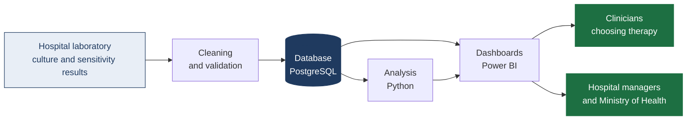
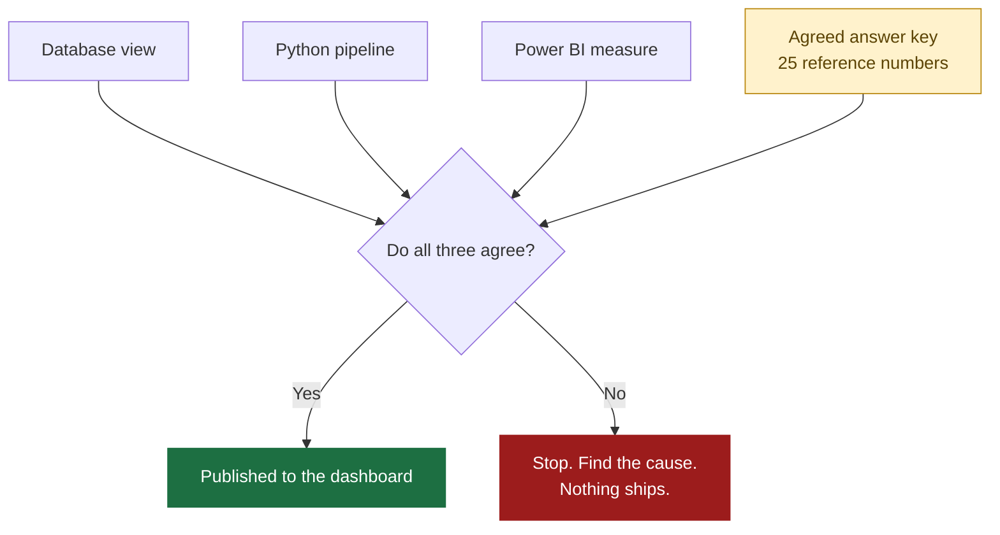
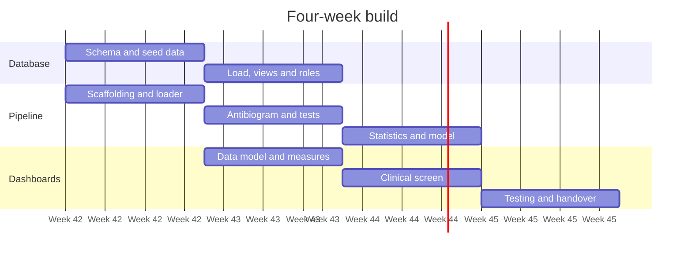

# Kaduna AMR Watch

### Which antibiotics still work in Kaduna?

A child arrives at a Kaduna hospital with a high fever. The doctor suspects the infection is in the blood. A culture is sent to the laboratory, but the result will take days, and the family may not be able to afford it at all. The child cannot wait. The doctor must choose an antibiotic **today**.

Which one? If the bacteria in that hospital are already resistant to the usual drug, the child receives a medicine that does nothing while the infection advances. The doctor is not careless. The doctor simply has no local data showing which antibiotics still work in that hospital, this year.

**This organisation exists to close that gap.**

---

## The evidence gap we are addressing

| | |
|---|---|
| Deaths in Nigeria directly caused by resistant bacteria (2019) | **64,500** |
| Deaths in Nigeria where resistant bacteria were involved (2019) | **263,400** |
| Published hospital resistance studies found for Kaduna State | **1** (Zaria, Sep–Dec 2021) |
| Kaduna facility-years with no public resistance data (6 hospitals x 7 years) | **34 of 42 (81%)** |
| UK Fleming Fund, a major AMR surveillance funder, final phase ended | **March 2026** |

Sources are catalogued with full citations in the project's evidence register. Every figure traces to a named source.

---

## What we build

A **cumulative antibiogram**: a table showing, for each organism, the percentage of isolates still susceptible to each antibiotic, broken down by hospital, specimen and year. Plus the system that produces it continuously rather than once.

---

## Repositories

| Repository | What lives there |
|---|---|
| [`kaduna-amr-sql`](https://github.com/AMR-Playbook/kaduna-amr-sql) | **Database.** The schema, the loading process, the privacy controls and the reporting views. Everything downstream reads from here. |
| [`kaduna-amr-python`](https://github.com/AMR-Playbook/kaduna-amr-python) | **Pipeline.** Reproducible analysis in Python: antibiogram rebuild, trend statistics with uncertainty, and the resistance risk model. |
| [`kaduna-amr-powerbi`](https://github.com/AMR-Playbook/kaduna-amr-powerbi) | **Dashboards.** Power BI data model, measures, the clinical antibiogram screen and the management view. |

Data cleaning is done in Excel and has no repository. The cleaned workbook is committed to `kaduna-amr-sql/seed/` as the single agreed input, and is also available as a [release download](https://github.com/AMR-Playbook/.github/releases/tag/excel-handoff-v2).

---

## Data governance

**The data currently in this organisation is synthetic.** It was generated to let the team build and test the system before real hospital data is available. It describes invented patients in four fictional hospitals. It is practice material and must never be presented as a finding about Kaduna.

Every chart, table and dashboard built from it carries a SYNTHETIC label.

When real data arrives, the following apply without exception:

- Patient-level data enters only after written hospital agreement and ethics approval from the facility and the Kaduna State Ministry of Health.
- No names, telephone numbers or addresses are stored. Patient identifiers are hashed before loading.
- Processing follows the Nigeria Data Protection Act 2023.
- Data about a hospital is shared with that hospital first, as a tool for improvement, never for comparison in public.
- **Our dashboards inform clinical decisions. They never replace clinical judgement, and this organisation does not give medical advice.**

---

## How a result becomes trustworthy here

Every headline number is rebuilt independently in three tools. If the database, the Python pipeline and the Power BI model disagree, work stops until the cause is found.

No percentage is ever published without the number of isolates it was calculated from. Results based on fewer than 30 isolates are marked unreliable and are not used for treatment guidance.

---

## Project timeline

**Checkpoint 1** (end of week 2): the three tools agree on the answer key.
**Checkpoint 2** (end of week 4): someone who did not build the system can rebuild it from the documentation alone.

---

## For clinicians and health partners

If you work in a Kaduna facility and would like to discuss contributing laboratory data, or you would like to review what we produce before it reaches any ward, please open an issue in the relevant repository or contact the project lead.

We would rather be corrected early by a microbiologist than be confidently wrong in front of a patient.
