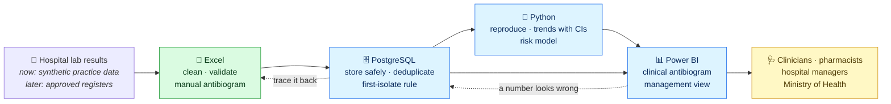
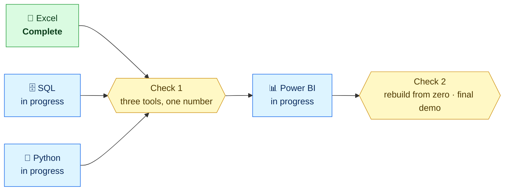

# Kaduna AMR Watch

### Which antibiotics still work in Kaduna?

An open, carefully documented antimicrobial resistance (AMR) surveillance pipeline for Kaduna State, Nigeria.
It turns hospital laboratory results into a local **antibiogram**, so clinicians can choose empiric therapy with evidence instead of guesswork.

> [!IMPORTANT]
> **All results in this organisation currently come from synthetic practice data.** They show how the system works, not what is happening in Kaduna. Nothing here is a clinical finding, and nothing here replaces clinical judgement. Real findings will come only from approved hospital data under ethics approval.

---

## The clinical problem

A child arrives at a Kaduna hospital with a high fever and suspected bloodstream infection. A blood culture takes days, and the family may not be able to pay for it. The clinician has to choose an antibiotic **today**.

If local bacteria are already resistant to the usual drug, that choice fails while the infection progresses. The clinician isn't being careless. They simply have **no current, local resistance data** for their hospital.

| What we know | Figure |
|---|---|
| Deaths in Nigeria directly attributable to bacterial AMR, 2019 | **64,500** |
| Deaths in Nigeria associated with bacterial AMR, 2019 | **263,400** |
| Published hospital resistance studies found for Kaduna | **1** (Zaria, 2021) |
| Kaduna facility-years (6 hospitals × 7 years) with no public resistance data | **34 of 42 (81%)** |

Death estimates: Global Research on Antimicrobial Resistance (GRAM) / IHME, 2019. Coverage figures: project evidence review. Sources are kept in the project evidence workbook and are being independently verified.

## What we are building

The core product is a **cumulative antibiogram**: for each organism, the percentage of isolates susceptible to each antibiotic, by hospital, specimen and year. Every percentage is shown with its count.

## Methods we hold ourselves to

| Standard | What it means in practice |
|---|---|
| **First-isolate rule** | Only the first isolate of each organism per patient per period is counted, so one very sick patient can't dominate the results (CLSI M39 approach). |
| **Minimum 30 isolates** | Results based on fewer than 30 isolates are greyed out and flagged as unreliable. |
| **No percentage without its count** | 80% of 5 isolates and 80% of 500 isolates are never shown the same way. |
| **Three tools, one number** | Excel, SQL and Python each rebuild the headline figures independently. If they disagree, work stops until the cause is found. |
| **Uncertainty is reported** | Trends carry 95% Wilson confidence intervals. "Rising" is claimed only when a statistical test supports it. |
| **WHO AWaRe stewardship** | Antibiotics are shown with their Access, Watch or Reserve group, so a working Access drug is visibly preferred. |
| **Breakpoint awareness** | The guideline (CLSI or EUCAST, with year) is stored with every result, because they can't be pooled blindly. |
| **Models never use hindsight** | Risk models use only what a clinician knows at the moment of prescribing, and are evaluated on later years than they were trained on. |

## Safeguards

- 🔒 **Patient privacy.** No names, phone numbers or addresses ever enter the system. Patient identifiers are hashed before loading. We follow the **Nigeria Data Protection Act 2023** and the conditions of any ethics approval.
- 🏷️ **Synthetic is never evidence.** Every chart, table and slide built on practice data is labelled `SYNTHETIC`.
- 🤝 **No shaming hospitals.** A hospital sees its own results first, as a tool for improvement.
- 🩺 **Clinical decisions belong to clinicians.** Our outputs inform prescribing. They never replace clinical judgement, and we never give medical advice.

## Progress

| Workstream | Repository | Status |
|---|---|---|
| 📗 **Data cleaning & manual antibiogram** (Excel) | [Clean Handoff Pack v2](https://github.com/AMR-Playbook/.github/releases/tag/excel-handoff-v2) | ✅ **Complete** |
| 🗄️ **Database & trusted views** (PostgreSQL) | [`kaduna-amr-sql`](https://github.com/AMR-Playbook/kaduna-amr-sql) | 🔵 In progress |
| 🐍 **Reproducible analysis, trends & risk model** (Python) | [`kaduna-amr-python`](https://github.com/AMR-Playbook/kaduna-amr-python) | 🔵 In progress |
| 📊 **Clinical & management dashboards** (Power BI) | [`kaduna-amr-powerbi`](https://github.com/AMR-Playbook/kaduna-amr-powerbi) | 🔵 In progress |

### The Excel deliverable

The Excel squad's work is finished and published as a single workbook, **[Kaduna_AMR_Clean_Handoff_v2.xlsx](https://github.com/AMR-Playbook/.github/releases/tag/excel-handoff-v2)**:

- **9,108** clean isolates (40 duplicate entries removed) and **94,454** susceptibility test results
- **44** messy organism spellings mapped to **11** standard organisms, verified at 100% accuracy
- A full data dictionary, cleaning log, quality scorecard per hospital and validated data-entry templates
- Manual antibiograms for 2024 and 2025 with the 30-isolate rule applied
- An **answer key** that the SQL, Python and Power BI work must each reproduce
- An audit of the squad's own files that found and fixed **16 errors** before handoff

## Get involved

Each repository has a short list of open issues, labelled by area and checkpoint. Start with the repository README, then read [`CONTRIBUTING.md`](https://github.com/AMR-Playbook/.github/blob/main/CONTRIBUTING.md).

Hospitals, laboratory scientists, clinicians and pharmacists in Kaduna State who would like to discuss data partnerships are very welcome. Please open a discussion or contact the maintainers.

Built in Kaduna. Synthetic data for practice, real data only with approval. Every number with its count.

